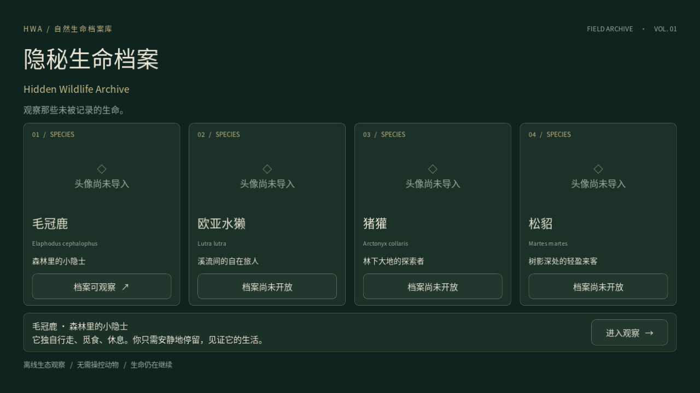
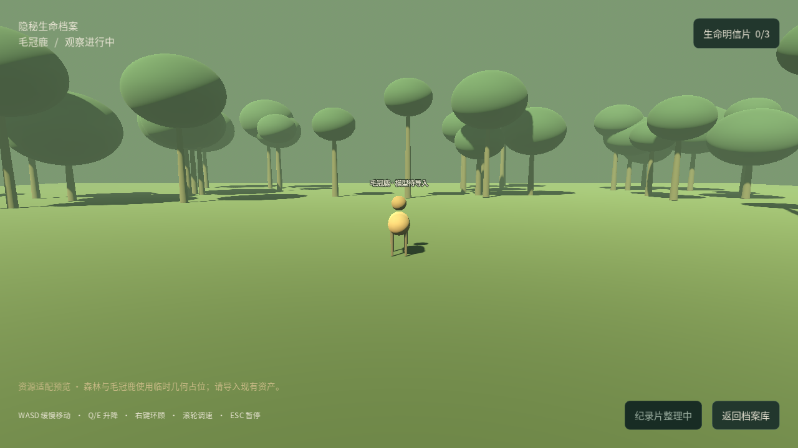

# 验证报告

验证日期：2026-10-07。引擎：Godot 4.6.3 stable。平台：Debian 13。源码面向 Godot 4.3+，其他版本和导出的桌面包没有实际验证。

## 已通过

- 编辑器资源扫描与脚本导入：无脚本解析错误。
- `tests/Smoke.tscn`：**42 项检查，0 失败**。覆盖主页卡片、未开放物种、需求变化、随机 FSM、三个实际移动事件、暂停、收藏、持久化、纪录片解锁、缺失资源回退、相机输入和重置。
- `tests/NaturalFlow.tscn`：**3 次默认参数自然流程通过**。保持初始观察者静止，正常动物移动速度，不使用 F1–F4、不伪造事件。随机种子 42 / 771 / 2026 分别在 **126.1 / 131.2 / 136.8 秒模拟时间**完成，测试自动关闭明信片以继续流程。`--fixed-fps` 加速了测试的实际墙钟执行，不代表现场无需等待。
- `tests/Interactions.tscn`：在 **Xvfb 图形显示 + OpenGL/Mesa** 下 **19 项交互检查，0 失败**。物理输入覆盖右键捕获和松开、鼠标旋转、滚轮、ESC；F1–F4 启用/禁用、收藏和明信片 ESC、真实场景切换及返回、进度保留均通过。
- 同一交互测试在 headless 下：17 项通过、2 项明确跳过。无显示模式不支持指针捕获/捕获式旋转；这两项已在上述图形模式验证，不能把 headless 跳过当成通过。
- 本地 Ogg Theora 视频：用独立两秒纯色测试片启动真实 VideoStreamPlayer，收到真实 finished 信号，结束文案正确。测试片不作为最终游戏内容使用。
- `tests/test_import_assets.py`：**8 个集成测试通过**。只读检查不改文件、GLTF 外部 BIN/贴图保留、重复导入、已有文件保护、路径越界拒绝、歧义不猜、手动映射、MP4 不误映射为可播放资源。
- 主页与森林观察界面已实际渲染和查看；中文字体、四卡片排版、HUD 和占位鹿可见。

以上计数属于不同测试套件；没有将同一检查的重复执行相加夸大覆盖。

## 交付包验证

源码 ZIP 已检查压缩完整性，并解压到独立目录。解压后的项目通过首次 Godot Import、Main → Home 启动和 42 项主流程检查。交付包不含 Git 元数据、Godot 导入缓存、用户存档或上传文件。

## 图形检查预览

以下只是当前**缺少真实资产**的预览，不能代表原资产导入后的画面：

## 尚未验证的素材适配

用户原始 ZIP 超过本次下载工具 32 MiB 上限，下载被拒绝；没有读取其目录或内容。没有用户原始模型、头像、明信片、动画、环境音或纪录片的实测结果。

需要在本地导入后检查：模型比例和朝向、骨骼动画名、森林地形/材质、真实导航网格、图片是否选对、视频格式/比例/音轨。默认矩形导航仅适用于平坦占位地面；复杂地形必须按中文说明 Bake。

交付为 Godot 源码项目，不含已导出的 Windows/macOS/Linux 可执行文件。导出模板和目标设备验证需在导出时完成。没有在线 LLM、第三方 Godot 插件、数据库或服务端依赖。
