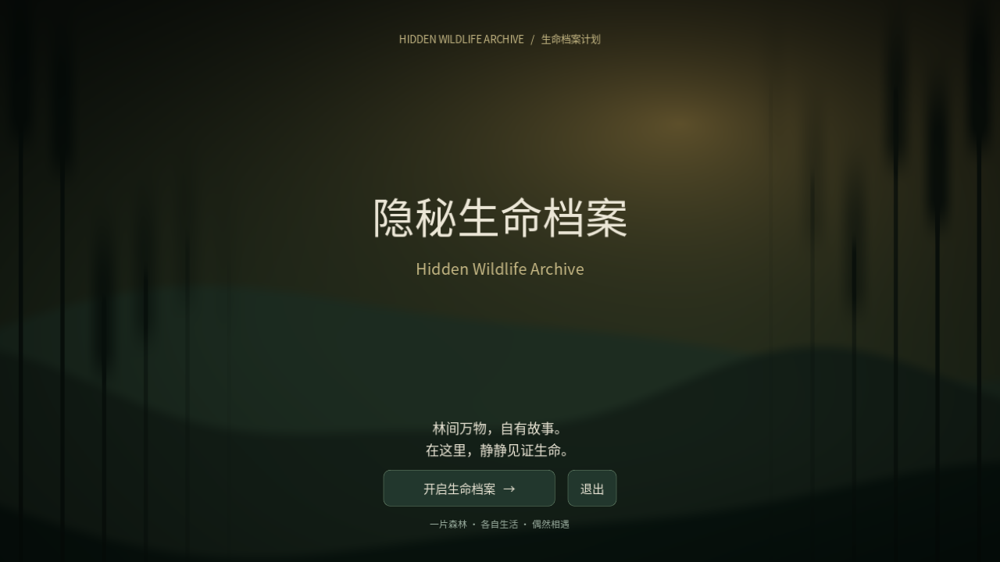

# 新版验证报告

日期：2026-10-07。引擎：Godot 4.6.3 stable。系统：Debian 13。图形检查：Xvfb + OpenGL/Mesa llvmpipe。面向 Godot 4.3+，其他版本和桌面导出包尚未实际测试。

本版调整为满好感与真实行为触发，取消固定延迟和事件先后限制。以下测试已在本版重新运行，原片播放与资产导入测试结果沿用上一版（相关代码/视频未修改）。

## 结果

| 检查 | 结果 | 内容 |
|---|---|---|
| Smoke.tscn | **43 项通过，0 失败** | 四动物选择、三次真实移动事件、明信片、暂停、收藏、JSON、导航回退、观察操作、档案生成和播放器缺失保护 |
| EventRules.tscn | **25 项通过，0 失败** | 99/100 边界、任意鹿主动靠近、任意双向满好感鹿真实玩耍、较远未访问区域、三事件独立、队列与重载、加快好感增长 |
| AnimalMinds.tscn | **37 项通过，0 失败** | 开场四鹿 + 剧情伙伴、独立身份/人格/导航、安静增加好感、惊扰记忆、提前逃离、方向同类好感、栖地帮助按真实受益记录、重启记忆与关系、v1 存档迁移、重置保护、生成档案内容真实 |
| Interactions.tscn（图形） | **22 项通过，0 失败** | 开始页到选择页、森林、右键捕获/旋转/释放、滚轮、ESC、F1–F4、明信片和收藏、生成与播放页实际切换、返回观察和保存进度 |
| Interactions.tscn（headless） | **20 项通过，2 项跳过** | 无显示驱动不能捕获鼠标及捕获式旋转；这两项已在图形模式通过 |
| NaturalFlow.tscn | **3 次通过** | 本版默认动物速度和事件规则，观察者静止，无强制事件；随机种子 42/771/2026 分别用 41.1/81.8/39.1 秒模拟时间完成三片段 |
| SuppliedVideo.tscn | **3 项通过，0 失败** | 原用户视频转码资源实际加载、带音轨启动、约 **14.01 秒实际时间**后收到 finished 并显示结束文本 |
| test_import_assets.py | **8 个测试通过** | 只读检查、依赖路径保留、重复导入、保护已有文件、拒绝越界路径、歧义不猜、显式映射、MP4 不误标为可播放 |
| 编辑器 Import | 通过 | 无脚本解析错误 |

主流程/记忆测试用 fixed-fps 加速执行，记录的是模拟时间，不是现场墙钟速度。有音轨的视频受真实音频时钟影响，因此额外单独进行实际时间播放检查；没有把快速模拟超时误报为视频缺陷。

实际视频检查：1280×720，Theora 视频 337 帧 / 24fps，Vorbis 音轨，14.048 秒。保留上传 MP4 的画面和声音。没有把测试片作为用户纪录片展示。

以上是不同套件计数，不把重复运行相加夸大覆盖。测试使用独立的 hidden_wildlife_test.json 和 hidden_wildlife_documentary_test.json，不覆盖玩家文件。

## 开始页预览

此截图是游戏图标原文件尚未复制时的文字回退。开始页已支持原图槽位：assets/ui/游戏标题.png。原图加载和保持比例的逻辑用独立本地测试图核验，不能声称用户原图已作为文件集成。

## 仍需本地验证

- 原森林/鹿 GLB、四种动物头像和三张明信片只在用户电脑里；云端尚无这些文件。模型材质、单位/朝向、动画名字、真实地形导航等待本地核验。
- 游戏标题仅以内嵌图片出现在聊天，没有可下载文件 ID。用户需将原素材的游戏标题.png 复制到 assets/ui，无需改名。
- 默认为平地导航。复杂森林需 Bake；有限范围直线回退不避树木、石头或陡坡。
- 交付为源码项目，没有导出或验证桌面 EXE。
- “生成”是本地整理包含人格、记忆、关系、已记录片段的个人档案并准备预制影片。没有在线 AI、没有生成新视频画面，也没有声称不同进度会生成不同影片。
